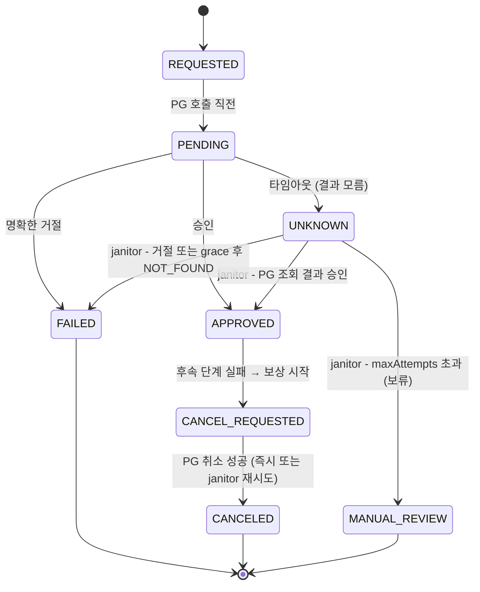

# 07. 결제 상태 머신 · 보류 · 보상 · 재처리

## 문제

- 결제 상태를 `status = 'APPROVED'` 처럼 아무 데서나 바꾸면, "실패한 결제가 승인으로 되살아남" 같은 불가능한 전이가 생긴다.
- PG 호출이 **타임아웃**나면 승인됐는지 모른다. 실패로 단정하고 재결제를 유도하면 **이중 결제**.
- 결제는 승인됐는데 **다음 단계(재고 확보)가 실패**하면? PG 승인과 재고는 한 DB 트랜잭션으로 묶을 수 없다.
- 보상(취소)마저 실패하면?

## 해결

**1) 명시적 상태 머신**



- 허용 전이표를 코드에 두고, 표에 없는 전이는 `ErrInvalidTransition`.
- 전이는 `UPDATE ... SET status = :to WHERE id = :id AND status = :from` (**compare-and-set**) + 이력 insert 를 한 트랜잭션에서. 0행이면 누군가 먼저 바꾼 것 → `ErrStaleStatus`.

**2) 타임아웃 = UNKNOWN, janitor 가 확정**

`Janitor.ReconcileUnknown(now)` 이 `UNKNOWN AND next_retry_at <= now` 를 `FOR UPDATE SKIP LOCKED` 로 집으면서 `attempt_count` 를 1 올리고(= 확인 1회), PG 조회 API(`GetStatus(idempotencyKey)`)를 부른다.
- APPROVED / FAILED → 확정
- NOT_FOUND → 요청이 PG 에 도달 못했을 가능성. 단, PG 반영이 늦을 수 있으니 `created_at + NotFoundGrace` 까지는 단정하지 않는다.
  - grace 안: **시도 횟수를 쓰지 않고**(올린 1 을 되돌림) `next_retry_at = created_at + NotFoundGrace` 로 재예약
  - grace 이후: FAILED
  - 왜? grace 안의 NOT_FOUND 를 "실패한 확인"으로 세면, 백오프 합(1분+2분)이 grace(5분)보다 짧아서 grace 가 끝나기도 전에 MANUAL_REVIEW 로 가 버린다 (돈이 안 빠진 결제가 사람 손으로 넘어감).
- 결론 못 냄(조회 장애 등) → 지수 백오프로 `next_retry_at` 갱신 (1분, 2분, 4분…, 지수 상한 20), `MaxAttempts` 회째에도 결론이 없으면 **MANUAL_REVIEW**(보류, 사람 확인)

**3) 보상 (Saga 의 가장 작은 형태)**

`CheckoutOrchestrator.Checkout`: 결제 승인 → 재고 확보 실패 시 **먼저 `CANCEL_REQUESTED` 를 기록하고** PG 취소를 부른다.
취소 성공 → `CANCELED`. 취소 실패 → `CANCEL_REQUESTED` 로 남고(`attempt_count = 1`, `next_retry_at = 지금 + CancelRetryDelay`) `Janitor.RetryCancels` 가 백오프하며 재시도 (취소는 포기할 수 없다).
`CANCEL_REQUESTED` 를 기록할 때부터 `next_retry_at` 을 "지금 + 지연"으로 둔다: 이 요청이 취소를 부르는 동안 janitor 가 같은 건을 집어 경쟁하지 않게.
"기록 먼저, 외부 호출 나중": 취소 호출 중 프로세스가 죽어도 기록이 남아 있으므로 janitor 가 이어서 처리한다.

## 핵심 코드 위치

- `state.go:29` 허용 전이표, `state.go:69` `TransitionTx` — `:77` compare-and-set UPDATE, 이력 insert
- `payment_service.go:19` `Pay` — `:63` **타임아웃 → UNKNOWN** (FAILED 가 아닌 이유)
- `janitor.go:56` `ReconcileUnknown` — `:70` `FOR UPDATE SKIP LOCKED` + attempt_count +1, `:100` NOT_FOUND + grace(`:117` grace 안은 시도 안 씀), `:133` MANUAL_REVIEW, `:148` 지수 백오프(`janitor.go:38`, 지수 상한 `:32`, Base 가 커도 int64 최댓값에서 멈춤)
- `janitor.go:174` `RetryCancels` — 취소 재시도
- `orchestrator.go:67` `Checkout` — `:89` 보상: 기록 먼저, 외부 호출 나중, `:106` 취소 실패 시 지연 후 재시도 예약
- `gateway.go` Fake PG — `TimeoutBeforeCharge`, `TimeoutAfterCharge`, `FailCancel`, `FailStatusQuery`

## 테스트 실행

```bash
cd go
go test ./07-payment-state-machine/ -v
```

| 테스트 | 증명하는 것 |
|---|---|
| `Test_invalid_transition__rejected` | REQUESTED→APPROVED, FAILED→APPROVED 거부, 상태/이력 변화 없음 |
| `Test_every_transition_recorded_in_history` | 성공 결제의 이력 = (∅→REQUESTED, REQUESTED→PENDING, PENDING→APPROVED) |
| `Test_concurrent_transition__only_one_wins` | goroutine 10개가 PENDING 에서 동시 전이 → 1개만 성공, 9개 `ErrStaleStatus`, 이력 1줄 |
| `Test_pg_timeout_after_charge__unknown__janitor_confirms_approved` | 승인 후 응답 유실 → UNKNOWN → janitor 가 APPROVED 확정, 재결제 없음 |
| `Test_pg_timeout_before_charge__unknown__janitor_marks_failed` | PG 미도달 → UNKNOWN → grace 내에는 보류(attempt_count 0 유지) → grace 후 FAILED |
| `Test_not_found_within_grace__does_not_consume_attempts__ends_failed` | `next_retry_at` 을 그대로 따라가며 janitor 실행 → MANUAL_REVIEW 가 아니라 FAILED, attempt_count = 1 (grace 후 확정 1회만 셈) |
| `Test_backoff__large_attempt__capped_without_overflow` | attempt 1~100 에서 백오프가 0 이하로 오버플로하지 않고 단조 증가, 상한 = Base << 20 |
| `Test_unknown_exceeds_max_attempts__moved_to_manual_review` | 조회 장애 지속 → 1분/2분 백오프 확인 → 3회째 MANUAL_REVIEW, 이후 janitor 가 건드리지 않음 |
| `Test_downstream_failure__compensated_by_pg_cancel` | 재고 실패 → PG 취소 → CANCELED |
| `Test_cancel_failure__left_cancel_requested__janitor_retries_cancel` | 취소 실패 → CANCEL_REQUESTED(attempt_count 1) → 지연 전엔 janitor 가 안 집음 → (장애 중 재예약) → 복구 후 janitor 가 CANCELED |

janitor 는 `now` 를 인자로 받으므로 테스트가 시간을 직접 진행시킨다 (sleep 없음).

## 운영 쿼리

```sql
-- 상태별 건수
SELECT status, count(*) FROM payments GROUP BY status ORDER BY status;

-- 오래된 UNKNOWN (janitor 가 멈췄거나 PG 조회 API 장애 의심)
SELECT id, order_id, amount, attempt_count, next_retry_at, last_error, now() - created_at AS age
  FROM payments
 WHERE status = 'UNKNOWN' AND created_at < now() - interval '10 minutes'
 ORDER BY created_at;

-- MANUAL_REVIEW 목록 (사람이 PG 어드민에서 idempotency_key 로 조회해 처리)
SELECT id, order_id, amount, idempotency_key, attempt_count, last_error, updated_at
  FROM payments WHERE status = 'MANUAL_REVIEW' ORDER BY updated_at;

-- 취소가 오래 안 끝나는 건 (돈을 돌려줘야 하는데 못 돌려준 상태)
SELECT id, order_id, pg_tx_id, attempt_count, last_error, next_retry_at
  FROM payments WHERE status = 'CANCEL_REQUESTED' AND updated_at < now() - interval '30 minutes';

-- 한 결제의 전체 이력
SELECT from_status, to_status, reason, created_at
  FROM payment_status_history WHERE payment_id = :id ORDER BY id;
```

## 한계 / 다음 단계

- `REQUESTED → PENDING` 후 PG 호출 전에 프로세스가 죽으면 PENDING 에 남는다. 실무에서는 "오래된 PENDING" 도 janitor 가 UNKNOWN 처럼 PG 조회로 정리한다.
- janitor 는 PG 조회를 트랜잭션(행 잠금) 안에서 한다. 조회는 상태를 바꾸지 않아서 괜찮지만, PG 가 느리면 잠금을 오래 쥔다. 대량이면 "집기(claim) → 커밋 → 조회 → 확정" 으로 나눈다 (Kotlin 버전이 이 방식).
- 같은 이유로, janitor 가 처리 도중 죽으면 트랜잭션이 롤백되어 집을 때 올린 `attempt_count` 도 사라진다. 처리할 때마다 죽는 행은 MANUAL_REVIEW 로 가지 않고 계속 재시도된다. Kotlin 은 claim 을 먼저 커밋하므로 이 경우도 시도로 세어 `maxAttempts` 초과 시 보류한다.
- UNKNOWN 상태에서는 다음 단계(재고)로 가지 않는다. janitor 가 APPROVED 로 확정한 뒤 이어서 처리하는 후속 트리거가 필요하다 (outbox 이벤트, 03).
- MANUAL_REVIEW 이후의 전이(사람이 승인/실패 확정)는 운영 도구의 몫으로 남겼다.
- 대사(09)는 이 모든 로직이 놓친 것을 마지막으로 잡는 안전망이다.
