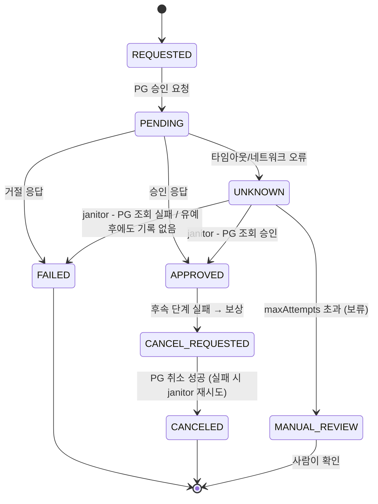

# 07. 결제 상태 머신 · 보류 · 보상 · 재처리

## 문제

- 결제 상태를 아무 코드에서나 `UPDATE status = ...` 하면, "승인된 결제가 실패로 바뀌는" 식의 불가능한 전이가 생긴다.
- PG 타임아웃을 **실패로 단정**하면, 실제로는 승인됐는데 주문은 실패 처리된다 → 고객 돈만 빠지고, 재결제하면 이중 결제.
- 결제는 승인됐는데 다음 단계(재고 확보)가 실패하면? PG 승인은 DB 롤백으로 되돌릴 수 없다.
- 확정이 안 되는 결제를 무한히 재시도할 수도, 그냥 버릴 수도 없다.

## 해결



1. **허용 전이표**를 코드에 명시 (`PaymentStatus.ALLOWED`). 표에 없는 전이는 `IllegalTransitionException`.
2. **compare-and-set 전이**: `UPDATE ... SET status = ? WHERE id = ? AND status = ?` + history insert를 한 트랜잭션에서. 0행이면 다른 처리가 먼저 바꿨다는 뜻 → 덮어쓰지 않고 실패.
3. **UNKNOWN**: 타임아웃은 "모름". janitor가 PG 조회 API로 확정한다.
   - `NOT_FOUND`라도 바로 FAILED로 보지 않는다 — 요청이 아직 PG에서 처리 중일 수 있다. `created_at + not-found-grace`가 지나야 FAILED.
   - 유예 시간 안의 `NOT_FOUND`는 **시도 횟수를 쓰지 않고** 유예가 끝나는 시각(`created_at + not-found-grace`)으로 바로 재예약한다. 시도로 세면 백오프 합(10+20+40+80s = 150s)이 유예(5m)보다 짧아서, 돈이 안 빠진 결제가 유예가 끝나기도 전에 MANUAL_REVIEW로 넘어간다.
   - 결론을 못 내면(PG 조회 장애 등) 지수 백오프(10s → 20s → 40s → 80s, 지수 상한 20)로 다시 확인. `max-attempts`회째에도 결론이 없으면 **MANUAL_REVIEW**(보류) — 사람이 PG 어드민이나 정산 파일(09)로 확인.
   - janitor는 `FOR UPDATE SKIP LOCKED`로 행을 고르고 `next_retry_at`을 lease만큼 미루면서 `attempt_count`를 1 올린 뒤 커밋(claim) → PG 조회 동안 잠금을 쥐지 않으면서도 다른 janitor와 겹치지 않는다.
   - claim에서 시도를 세므로 처리 도중 죽어도 시도로 남는다. `max-attempts`보다 많이 집힌 행(= 매번 처리하다 죽음)은 PG를 부르지 않고 MANUAL_REVIEW로 보낸다.
4. **보상(Saga)**: 재고 확보 실패 → 먼저 `CANCEL_REQUESTED`를 커밋해 "취소해야 함"을 기록 → PG 취소 → `CANCELED`. 취소가 실패하면 `CANCEL_REQUESTED`로 남고 janitor가 재시도한다. 보상이 유실되지 않는다. 재시도 중 다른 경로가 먼저 확정한 건(compare-and-set 0행)은 건너뛰고 배치의 나머지를 계속 처리한다.

## 핵심 코드 위치

- `src/main/kotlin/lab/statemachine/PaymentStatus.kt:19` — 허용 전이표
- `src/main/kotlin/lab/statemachine/PaymentStateMachine.kt:20` — 전이표 검사(`:29`) → CAS(`:32`) → history(`:35`)
- `src/main/kotlin/lab/statemachine/PaymentRepository.kt:41` — CAS UPDATE (`:49` `WHERE id = ? AND status = ?`)
- `src/main/kotlin/lab/statemachine/PaymentRepository.kt:70` — janitor claim (`FOR UPDATE SKIP LOCKED` + lease + attempt_count +1 `:73`)
- `src/main/kotlin/lab/statemachine/PaymentService.kt:15` — PENDING 선커밋(`:25`), PG 호출(`:29`), 타임아웃 → UNKNOWN(`:34`)
- `src/main/kotlin/lab/statemachine/Janitor.kt:30` — `reconcileUnknown`: crash loop 보류(`:34`), NOT_FOUND 유예(`:51`, 유예 안은 시도 안 씀 `:57`), MANUAL_REVIEW(`:91`), 백오프(`:101`)
- `src/main/kotlin/lab/statemachine/Janitor.kt:71` — `retryCancelRequested` (충돌 건 건너뛰기 `:77`)
- `src/main/kotlin/lab/statemachine/CheckoutOrchestrator.kt:42` — 보상: CANCEL_REQUESTED 선커밋(`:45`) → PG 취소(`:50`) → 실패 시 재시도 예약(`:55`)

## 테스트 실행

```bash
cd kotlin
./gradlew :07-payment-state-machine:test
```

janitor는 `now`를 인자로 받는다 → 테스트에서 시간을 "넘겨" 백오프/유예를 실제로 기다리지 않고 검증한다.

| 테스트 | 증명하는 것 |
|---|---|
| `invalid_transition__rejected` | APPROVED → FAILED, APPROVED → CANCELED(건너뛰기) 거부 |
| `every_transition_recorded_in_history` | null→REQUESTED→PENDING→APPROVED 가 모두 history에 |
| `concurrent_transition__only_one_wins` | 10 스레드가 UNKNOWN을 APPROVED/FAILED로 동시 확정 → 1개만 성공, history도 1건 |
| `pg_timeout_after_charge__unknown__janitor_confirms_approved` | 타임아웃 → UNKNOWN → janitor가 PG 조회로 APPROVED (재결제 없음) |
| `pg_timeout_before_charge__unknown__janitor_marks_failed` | 유예 시간 안엔 UNKNOWN 유지(attempt_count 0, 유예 끝 시각으로 재예약), 지난 뒤 FAILED |
| `not_found_within_grace__does_not_consume_attempts__ends_failed` | 기본 설정에서 `next_retry_at`을 그대로 따라가며 janitor 실행 → MANUAL_REVIEW가 아니라 FAILED, attempt_count = 1 |
| `unknown_exceeds_max_attempts__moved_to_manual_review` | PG 조회 장애 지속 → 백오프 10/20/40/80초 → 5회째 MANUAL_REVIEW |
| `downstream_failure__compensated_by_pg_cancel` | 재고 실패 → PG 취소 → CANCELED |
| `cancel_failure__left_cancel_requested__janitor_retries_cancel` | 취소 실패 → CANCEL_REQUESTED 유지 → PG 복구 후 janitor가 CANCELED |
| `cancel_retry__stale_row_skipped__rest_of_batch_processed` | 취소 재시도 중 한 건을 다른 경로가 먼저 확정 → 그 건은 건너뛰고 나머지 건도 CANCELED |
| `janitor_crash_loop__claims_counted__moved_to_manual_review` | claim만 하고 죽는 상황 5회 → 6번째 claim에서 MANUAL_REVIEW (attempt_count 6) |

## 운영 쿼리

```sql
-- 상태별 건수
SELECT status, count(*) FROM payments GROUP BY status ORDER BY status;

-- 오래된 UNKNOWN (janitor가 멈췄거나 PG 조회가 계속 실패 중)
SELECT id, order_id, amount, attempt_count, next_retry_at, last_error, now() - created_at AS age
FROM payments
WHERE status = 'UNKNOWN' AND created_at < now() - interval '10 minutes'
ORDER BY created_at;

-- 사람이 확인해야 할 결제 (MANUAL_REVIEW) + 마지막 전이 사유
SELECT p.id, p.order_id, p.amount, p.attempt_count, p.last_error, h.reason, h.created_at
FROM payments p
JOIN LATERAL (SELECT reason, created_at FROM payment_status_history
              WHERE payment_id = p.id ORDER BY id DESC LIMIT 1) h ON true
WHERE p.status = 'MANUAL_REVIEW'
ORDER BY h.created_at;

-- 취소가 계속 실패 중인 결제 (보상 미완료 → 고객 돈이 묶여 있음, 알림 대상)
SELECT id, order_id, attempt_count, next_retry_at, last_error
FROM payments WHERE status = 'CANCEL_REQUESTED' AND attempt_count >= 3;

-- 한 결제의 이력
SELECT from_status, to_status, reason, created_at
FROM payment_status_history WHERE payment_id = :id ORDER BY id;
```

## 한계 / 다음 단계

- 서버가 PG 호출 도중 죽으면 결제가 `PENDING`에 남는다. 실서비스에선 "일정 시간 이상 PENDING"도 UNKNOWN처럼 janitor가 조회해야 한다 (여기선 생략).
- `NOT_FOUND`로 FAILED 처리한 뒤 PG가 늦게 승인할 수도 있다(PG 내부 지연). 결국 **09 대사**(MISSING_IN_INTERNAL)가 잡아낸다.
- 취소 재시도는 포기하지 않고 백오프로 계속한다. 실패가 길어지면 알림(attempt_count 기준)을 걸어 사람이 개입한다.
- janitor는 여기서 테스트가 직접 호출한다. 실서비스에선 `@Scheduled` + 인스턴스 여러 대 (claim 덕분에 안전).
- 상태가 맞아도 "돈이 어디서 어디로 갔는지"는 별도 기록이 필요하다 → **08 원장**.
